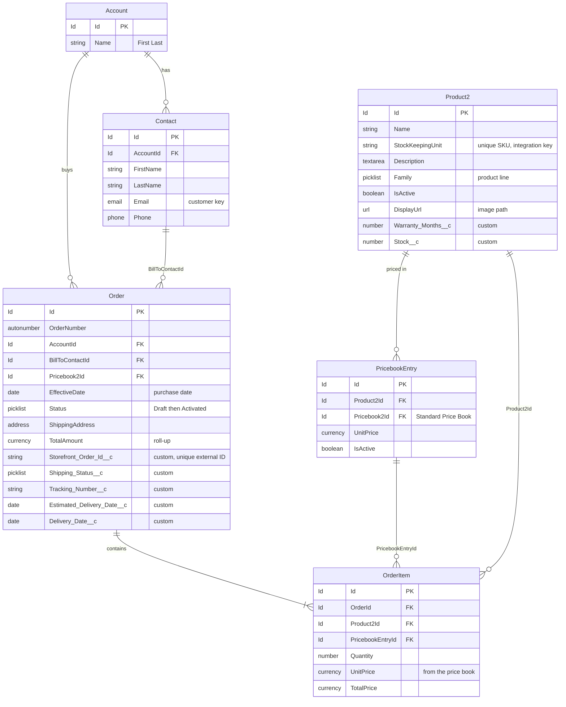

# Voltline data model and permissions

Story HU-02 (KAN-12) · API 67.0 · Source: `docs/mvp-spec.md` in the Voltline project

This is the Salesforce side of the Voltline store: the objects and fields behind the storefront, who can see and change them, and how to deploy everything from this repo into an org. The Store API, the triggers and the storefront are described in the spec, not here.

- [Data model](#data-model)
- [Permissions](#permissions)
- [Deploy](#deploy)

## Data model

Fields marked `custom` are added by this project. Everything else is standard Salesforce. API names and labels are in English. The only Spanish labels are two `Family` values (Celulares, Notebooks).



### What each object and field is for

| Object         | Field                                                                   | Shown on / used by       | Purpose                                                                                                                         |
| -------------- | ----------------------------------------------------------------------- | ------------------------ | ------------------------------------------------------------------------------------------------------------------------------- |
| Product2       | `Name`, `Description`                                                   | Catalog card             | What the customer sees.                                                                                                         |
|                | `StockKeepingUnit`                                                      | API key                  | Unique SKU. The store sends SKUs, never Salesforce Ids, and the seed upserts by it.                                             |
|                | `Family`                                                                | Catalog filter           | Product line. Values: Audio, Phones, Laptops, Wearables (labels: Audio, Celulares, Notebooks, Wearables).                       |
|                | `IsActive`                                                              | Catalog                  | Only active products are listed.                                                                                                |
|                | `DisplayUrl`                                                            | Catalog card             | Image path served by the storefront, e.g. `/products/VL-AUD-001.webp`.                                                          |
|                | `Warranty_Months__c` (Number 3,0)                                       | Catalog card             | "12-month warranty". The warranty rules use it later.                                                                           |
|                | `Stock__c` (Number 6,0, default 0)                                      | Catalog badges, checkout | Units available. Only the OrderItem trigger changes it after seeding.                                                           |
| PricebookEntry | `UnitPrice`                                                             | Catalog, order lines     | Price in the Standard Price Book. The API always prices items from here and never trusts the client.                            |
| Account        | `Name`                                                                  | Rep views                | Customer household, named "First Last". Account + Contact is kept instead of Person Accounts, which are irreversible to enable. |
| Contact        | `FirstName`, `LastName`, `Phone`                                        | Checkout form            | Customer details.                                                                                                               |
|                | `Email`                                                                 | Checkout, tracking       | Matching key: checkout reuses the Contact with the same email, and tracking verifies it.                                        |
| Order          | `OrderNumber`                                                           | Confirmation, tracking   | The number the customer keeps.                                                                                                  |
|                | `AccountId`, `BillToContactId`                                          | —                        | Who bought.                                                                                                                     |
|                | `EffectiveDate`                                                         | Tracking                 | Purchase date.                                                                                                                  |
|                | `Status`                                                                | —                        | Created as Draft, then Activated once items are in, which locks the lines.                                                      |
|                | `ShippingAddress`                                                       | Checkout form            | Delivery address. Never returned by the tracking API.                                                                           |
|                | `TotalAmount`                                                           | Confirmation, tracking   | Standard roll-up of the lines.                                                                                                  |
|                | `Storefront_Order_Id__c` (Text 36, External ID, Unique)                 | API                      | UUID the store generates for each checkout attempt. A retry returns the same order instead of a duplicate.                      |
|                | `Shipping_Status__c` (restricted picklist)                              | Tracking timeline        | Preparing (default), Shipped, Delivered. Reps move it forward.                                                                  |
|                | `Tracking_Number__c` (Text 30)                                          | Tracking                 | Carrier number. A validation rule requires it once the order is Shipped or Delivered.                                           |
|                | `Estimated_Delivery_Date__c` (Date)                                     | Confirmation, tracking   | Set by the trigger: purchase date plus the lead days in `Store_Setting__mdt`.                                                   |
|                | `Delivery_Date__c` (Date)                                               | Tracking                 | Stamped by the trigger when the order becomes Delivered. Later it starts the return window and the warranty.                    |
| OrderItem      | `Product2Id`, `PricebookEntryId`, `Quantity`, `UnitPrice`, `TotalPrice` | Confirmation, tracking   | One line per product.                                                                                                           |

### Configuration

| Component                                         | Purpose                                                                                                                                                                                                                                  |
| ------------------------------------------------- | ---------------------------------------------------------------------------------------------------------------------------------------------------------------------------------------------------------------------------------------- |
| `OrderSettings`                                   | Turns Orders on. Negative and zero quantities, optional price books, reduction orders, order events and enhanced commerce orders stay off. It lives in `force-app/setup` because it has to be deployed before anything that uses Order.  |
| Standard Price Book                               | Must be active, since every Order and PricebookEntry uses it. This is data, not metadata, so it is a deploy step.                                                                                                                        |
| `Store_Setting__mdt`, record `Default`            | Store parameters, read by Apex instead of hardcoding them: `Delivery_Lead_Days__c` (5) and `Max_Units_Per_Line__c` (5). Post-MVP it also holds the return window and the human-review threshold, replacing the old `Return_Policy__mdt`. |
| Validation rule `Order.Tracking_Number_Required`  | Blocks the save when `Shipping_Status__c` is Shipped or Delivered and `Tracking_Number__c` is blank. The error shows on the tracking number field: "You must enter the tracking number for orders with "Shipped" or "Delivered" state".  |
| External Client App `Voltline_Storefront` (HU-26) | OAuth client credentials, run as the integration user, scope `api`. The key and secret live only in the proxy's `.env`.                                                                                                                  |

### Rep views

| Component                                   | What it shows                                                                                                  |
| ------------------------------------------- | -------------------------------------------------------------------------------------------------------------- |
| `Product2-Product Layout`                   | Name, product code, SKU, stock, active, family, display URL, warranty months and description.                  |
| `Order-Order Layout`                        | The standard order fields plus the five custom fields, and the Order Products related list.                    |
| `Order_Detail_Page` (Lightning record page) | Highlights panel, details and related lists for Order. Activating it is a manual step (see [Deploy](#deploy)). |
| List view "Web orders by shipping status"   | All orders: number, shipping status, account, status, start date, delivery date, end date and total.           |
| List view "Low stock products"              | Products with `Stock__c` of 10 or less: stock, name, product code, family, description and SKU.                |

### Where it is in the repo

| Component                                     | Path                                                                                                                   | Ticket  |
| --------------------------------------------- | ---------------------------------------------------------------------------------------------------------------------- | ------- |
| `OrderSettings`                               | `force-app/setup/settings/`                                                                                            | KAN-42  |
| Product2 fields and `Family` values           | `force-app/main/default/objects/Product2/fields/`, `force-app/main/default/standardValueSets/`                         | KAN-43  |
| Order fields                                  | `force-app/main/default/objects/Order/fields/`                                                                         | KAN-44  |
| Validation rule                               | `force-app/main/default/objects/Order/validationRules/`                                                                | KAN-45  |
| `Store_Setting__mdt` and its `Default` record | `force-app/main/default/objects/Store_Setting__mdt/`, `force-app/main/default/customMetadata/`                         | KAN-46  |
| Permission sets                               | `force-app/main/default/permissionsets/`                                                                               | KAN-47  |
| Permission set groups                         | `force-app/main/default/permissionsetgroups/`                                                                          | KAN-110 |
| Layouts, record page and list views           | `force-app/main/default/layouts/`, `force-app/main/default/flexipages/`, `force-app/main/default/objects/*/listViews/` | KAN-48  |

### Added after the MVP

These items from the earlier draft move into the stories that need them, so the MVP model only covers what the store uses.

| Addition                                                                                                                                          | Story        |
| ------------------------------------------------------------------------------------------------------------------------------------------------- | ------------ |
| `OrderItem.Warranty_End_Date__c`, `Warranty_Active__c` (formulas) and the return fields on `Store_Setting__mdt`                                   | HU-05        |
| Case fields (`Order__c`, `Eligibility_Result__c`, `Eligibility_Reason__c`, `Escalation_Reason__c`, `Agent_Summary__c`) and the "Agente IA" origin | HU-06        |
| `Knowledge__kav.Product_Line__c`, with the same values as `Product2.Family`                                                                       | HU-07, HU-08 |
| `Agent_Action_Log__c`                                                                                                                             | HU-17        |

## Permissions

All access comes from permission sets bundled into permission set groups. Users are assigned groups, never single permission sets, and profiles stay as they are and out of the repo.

- **Why not the System Administrator profile.** A field deployed from the repo isn't visible to any profile unless the deploy grants it, so even admins need a grant. Permission sets are small, additive files that are easy to review, while profiles in source control are partial and can overwrite field access on deploy. The integration user and the reps aren't admins anyway.
- **Why it matters more on API 67.0.** The repo's `sourceApiVersion` is 67.0. From that version (Summer '26), Apex classes run database operations in user mode and default to `with sharing`. The integration user's permission sets therefore decide what the Store API can read and write, and a missing field grant becomes an API error. Triggers still run in system mode.

### Permission sets

These are the building blocks. None has a license, so each can go to any user type.

| Permission set            | Grants                                                                                                                                                                                                                                                                                                                                                                                                                                              |
| ------------------------- | --------------------------------------------------------------------------------------------------------------------------------------------------------------------------------------------------------------------------------------------------------------------------------------------------------------------------------------------------------------------------------------------------------------------------------------------------- |
| `Voltline_Store_Read`     | Read on Product2, Pricebook2, PricebookEntry, Account, Contact, Order and OrderItem. Read access to the custom fields and to the standard fields the API returns (`StockKeepingUnit`, `Family`, `DisplayUrl`, `BillToContactId`, `ShippingAddress`).                                                                                                                                                                                                |
| `Voltline_Storefront_API` | User permissions API Enabled, Apex REST Services and Activate Orders. Create on Account, Contact, Order and OrderItem, and Edit on Order to activate it. View All on Account, Contact and Order, so the API finds any customer's records. Edit access to the fields the API writes (contact name, email and phone, shipping address, `Storefront_Order_Id__c`). Class access to `ProductsResource` and `OrdersResource` (added by HU-28 and HU-29). |
| `Voltline_Fulfillment`    | Edit on Order and Product2. Edit access to `Shipping_Status__c`, `Tracking_Number__c` and `Stock__c`. Edit Activated Orders, so reps can update shipping after activation. Orders and Products tabs.                                                                                                                                                                                                                                                |
| `Voltline_Admin_Fields`   | Edit access to every Voltline custom field (read on formulas), plus the Orders and Products tabs.                                                                                                                                                                                                                                                                                                                                                   |

Tab settings stay out of the two sets the integration user gets, since it's an API-only user.

### Permission set groups

| Group                             | Permission sets                                                        | Assigned to                                                                                                        |
| --------------------------------- | ---------------------------------------------------------------------- | ------------------------------------------------------------------------------------------------------------------ |
| `Voltline_Storefront_Integration` | `Voltline_Store_Read`, `Voltline_Storefront_API`                       | The integration user, plus the Salesforce API Integration permission set license if it has the Integration license |
| `Voltline_Support_Rep`            | `Voltline_Store_Read`, `Voltline_Fulfillment`                          | Support reps                                                                                                       |
| `Voltline_Administrator`          | `Voltline_Store_Read`, `Voltline_Fulfillment`, `Voltline_Admin_Fields` | Mati and Joaquín, on top of their System Administrator profile                                                     |

### Permission matrix

The same grants, by object, field and permission. **R** = read, **C** = create, **E** = edit, **VA** = View All. A blank cell means the set doesn't grant it.

**Objects**

| Object         | Store_Read | Storefront_API | Fulfillment | Admin_Fields |
| -------------- | :--------: | :------------: | :---------: | :----------: |
| Product2       |     R      |                |      E      |              |
| Pricebook2     |     R      |                |             |              |
| PricebookEntry |     R      |                |             |              |
| Account        |     R      |     C, VA      |             |              |
| Contact        |     R      |     C, VA      |             |              |
| Order          |     R      |    C, E, VA    |      E      |              |
| OrderItem      |     R      |       C        |             |              |

**Fields**

| Field                              | Store_Read | Storefront_API | Fulfillment | Admin_Fields |
| ---------------------------------- | :--------: | :------------: | :---------: | :----------: |
| `Product2.StockKeepingUnit`        |     R      |                |             |              |
| `Product2.Family`                  |     R      |                |             |              |
| `Product2.DisplayUrl`              |     R      |                |             |              |
| `Product2.Warranty_Months__c`      |     R      |                |             |      E       |
| `Product2.Stock__c`                |     R      |                |      E      |      E       |
| Contact name¹                      |            |       E        |             |              |
| `Contact.Email`                    |            |       E        |             |              |
| `Contact.Phone`                    |            |       E        |             |              |
| `Order.BillToContactId`            |     R      |                |             |              |
| `Order.ShippingAddress`            |     R      |       E        |             |              |
| `Order.Storefront_Order_Id__c`     |     R      |       E        |             |      E       |
| `Order.Shipping_Status__c`         |     R      |                |      E      |      E       |
| `Order.Tracking_Number__c`         |     R      |                |      E      |      E       |
| `Order.Estimated_Delivery_Date__c` |     R      |                |             |      E       |
| `Order.Delivery_Date__c`           |     R      |                |             |      E       |

¹ First and last name come with Create and Edit on Contact. They have no separate field permission.

The two date fields need no edit grant for the API, because the Order trigger sets them in system mode. Stock is the same: the OrderItem trigger updates it with `update as system`.

**User permissions, classes and tabs**

| Permission                                          | Store_Read | Storefront_API | Fulfillment | Admin_Fields |
| --------------------------------------------------- | :--------: | :------------: | :---------: | :----------: |
| API Enabled                                         |            |       ✓        |             |              |
| Apex REST Services                                  |            |       ✓        |             |              |
| Activate Orders                                     |            |       ✓        |             |              |
| Edit Activated Orders                               |            |                |      ✓      |              |
| `ProductsResource`, `OrdersResource` (HU-28, HU-29) |            |       ✓        |             |              |
| Orders and Products tabs                            |            |                |   Visible   |   Visible    |

### Rules

- A new field or object ships in the same pull request as the permission set change that exposes it, including `Voltline_Admin_Fields`.
- `**/profiles/**` is in `.forceignore`, so a retrieve never pulls profiles into the repo.
- Code that must ignore the running user's access says so explicitly. The stock update uses `update as system`, which is why the integration user needs no Edit on Product2.
- The order services stay `with sharing`. They find any customer's records through View All in `Voltline_Storefront_API`, not through `without sharing`.
- `StoreSettings` reads `Store_Setting__mdt` with `getInstance()`, which needs no grant.
- Apex tests for the REST classes run with `System.runAs` as a user assigned the group, after `Test.calculatePermissionSetGroup()`. The rep steps of the end-to-end script are done as a user with only `Voltline_Support_Rep`.
- A group can only be assigned once its status is Updated. Use a muting permission set only if a group must lose a permission it inherits; none is needed yet.

### After the MVP

| Story | Permission change                                                                                                                                                                                                                           |
| ----- | ------------------------------------------------------------------------------------------------------------------------------------------------------------------------------------------------------------------------------------------- |
| HU-04 | New `Voltline_Agent_Actions`: class access to the invocable actions. HU-05 and HU-06 add theirs.                                                                                                                                            |
| HU-05 | Read on the warranty formulas added to `Voltline_Store_Read`.                                                                                                                                                                               |
| HU-06 | New `Voltline_Case_Management`: Case access and the new Case fields. Added to the Support Rep and Administrator groups.                                                                                                                     |
| HU-07 | New `Voltline_Knowledge_Read`: Knowledge and `Product_Line__c`. Added to the Support Rep and Administrator groups.                                                                                                                          |
| HU-10 | New group `Voltline_Support_Agent` = `Voltline_Store_Read` + `Voltline_Agent_Actions` + `Voltline_Case_Management` + `Voltline_Knowledge_Read`, for the agent user. No `Voltline_Fulfillment`, so the agent can't change shipping or stock. |
| HU-15 | New `Voltline_Omnichannel`: presence statuses and MessagingSession. Added to the Support Rep and Administrator groups.                                                                                                                      |
| HU-17 | New `Voltline_Agent_Log_Read`: read on `Agent_Action_Log__c` and the LWC controller. Added to the Support Rep and Administrator groups. `Voltline_Agent_Actions` gets Create on the log.                                                    |

## Deploy

The repo has two source folders inside `force-app`, deployed in this order:

| Folder            | Contents        | Why it goes first or second                                                         |
| ----------------- | --------------- | ----------------------------------------------------------------------------------- |
| `force-app/setup` | `OrderSettings` | Orders must be enabled before anything on Order or OrderItem can deploy.            |
| `force-app/main`  | Everything else | Fields, rules, custom metadata, permission sets and groups, layouts and list views. |

Deploy by folder, not with `--source-dir force-app`, which would send both in one deployment.

### Prerequisites

- A Developer Edition org, with your user on the System Administrator profile
- Salesforce CLI (`sf`) and Git

### Steps

Run these from a fresh clone, not from your working copy, so a local file that was never committed can't make the deploy pass.

1. Clone the repo and check out the branch to deploy:

   ```bash
   git clone https://github.com/Keromon2k19/voltline-support.git voltline-clean
   cd voltline-clean
   git checkout develop
   ```

2. Log in to the org and make it the default:

   ```bash
   sf org login web --alias voltline --set-default
   ```

3. Deploy `setup` to enable Orders:

   ```bash
   sf project deploy start --source-dir force-app/setup
   ```

4. Activate the Standard Price Book. Look up its Id, then set it active if `IsActive` is false:

   ```bash
   sf data query --query "SELECT Id, IsActive FROM Pricebook2 WHERE IsStandard = true"
   sf data update record --sobject Pricebook2 --record-id <PRICEBOOK_ID> --values "IsActive=true"
   ```

5. Deploy `main`. Add `--dry-run` first if you want to validate without saving anything:

   ```bash
   sf project deploy start --source-dir force-app/main
   ```

6. Wait until every Voltline group shows `Updated`. Groups are recalculated after each deploy and can't be assigned before that:

   ```bash
   sf data query --query "SELECT Id, DeveloperName, Status FROM PermissionSetGroup WHERE DeveloperName LIKE 'Voltline%'"
   ```

7. Assign `Voltline_Administrator` to yourself. A group assignment is a `PermissionSetAssignment` record with `PermissionSetGroupId` instead of `PermissionSetId`. Take the group Id from step 6 and your user Id from `sf org display user`:

   ```bash
   sf org display user
   sf data create record --sobject PermissionSetAssignment --values "AssigneeId=<USER_ID> PermissionSetGroupId=<GROUP_ID>"
   ```

   Skip this step if you already have the group. A second assignment fails as a duplicate.

8. Activate the Order record page. In Setup, open `Order Detail Page` in Lightning App Builder and assign it as the org default for Order. Activation isn't stored in the repo.

### Check the result

- The Orders and Products tabs are visible.
- A product record shows SKU, display URL, stock and warranty months.
- An order record shows the five custom fields and the Order Products list.
- Setting an order to Shipped with no tracking number shows the validation error on the tracking number field.
- The "Web orders by shipping status" and "Low stock products" list views appear.
- `Store_Setting__mdt` has the `Default` record with 5 and 5 (Setup → Custom Metadata Types → Store Setting → Manage Records).

### If something fails

| Symptom                                                       | Cause and fix                                                                                                                              |
| ------------------------------------------------------------- | ------------------------------------------------------------------------------------------------------------------------------------------ |
| The `main` deploy fails on Order components                   | Orders aren't enabled yet. Run step 3 first.                                                                                               |
| `no CustomField named <Object>.<Field>__c found`              | A permission set references a field that isn't in the repo or in the org. Remove it from the permission set, or add the field to the repo. |
| The assignment in step 7 fails on the group                   | The group isn't `Updated` yet. Re-run the query from step 6 and try again.                                                                 |
| Creating an Order or an order product fails on the price book | The Standard Price Book is inactive. Repeat step 4.                                                                                        |
